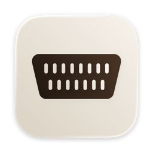
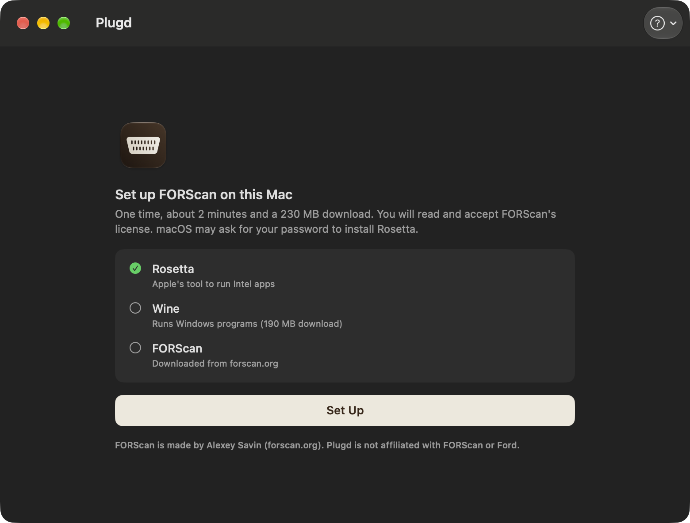
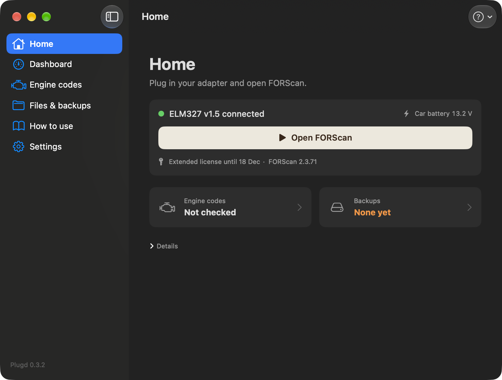

<h1 align="center">Plugd</h1>

FORScan on a Mac, for free.

<a href="https://github.com/lncch/Plugd/releases/latest/download/Plugd.dmg"><b>Download for Mac</b></a> · macOS 14+ · Apple Silicon or Intel · USB OBD adapter

 

I have a Ford Taurus, and every time I wanted to turn a feature on or off with FORScan I had to dig out a Windows laptop. FORScan is Windows only. The usual ways around that on a Mac cost money: CrossOver, or Parallels or downloading a whole VM.

So I vibe coded this app. It runs FORScan on my Mac through Wine (free software that runs Windows programs), and it does the annoying setup for you. You click Set Up, plug in your adapter, and click Open FORScan.

I've used it on my own car and it works.

## What it does

- Installs Wine and downloads FORScan from forscan.org (it doesn't ship FORScan itself)
- Finds your USB OBD adapter and connects FORScan to it
- Gives FORScan a folder on your Mac (it shows up as drive O:) for license keys and As-Built backups
- Warns you when you don't have a backup yet
- Reads engine codes and battery voltage without opening FORScan
- Shows a live dashboard (RPM, speed, temperatures, fuel and more) while FORScan is closed
- Lives in the menu bar if you want, and can start at login
- Tells you when a new FORScan version is out, and when your license runs out

## Install

1. Download `Plugd.dmg`, open it, and drag Plugd into Applications.
2. Open it. The first time, macOS blocks it because I haven't paid Apple to notarize it. Go to System Settings → Privacy & Security and click **Open Anyway**.
3. Click **Set Up** and accept FORScan's license. It takes about 2 minutes and downloads about 230 MB.
4. Plug in your adapter and click **Open FORScan**.

Back up before you change anything, and keep a battery charger on the car while FORScan writes.

## Tested on

| Car | Adapter | Reads | Writes |
|---|---|---|---|
| 2023 Ford Taurus, Middle East (Mondeo EVOS, 2021 MY) | cheap ELM327 v1.5 clone, CH340 chip, HS/MS switch | 22+ modules | yes, checked in the car |

That's one car and one adapter. Intel Macs are new in 0.3.2: I've only tested the Intel version through Rosetta on my M-series Mac, not on a real Intel Mac. If you try it on yours, open an issue and tell me how it went.

## Build it yourself

You need the Xcode command line tools and `brew install innoextract dylibbundler`. The first build also runs `tools/innoextract-x86.sh`, which fetches the Intel half of innoextract (hash-checked). Then:

    ./build.sh

There are test hooks that run without a window, for example with a fake adapter from ELM327-emulator:

    PLUGD_HOME=/tmp/empty Plugd.app/Contents/MacOS/Plugd --headless-setup
    PLUGD_HOME=/tmp/empty PLUGD_PORT=/dev/ttys008 Plugd.app/Contents/MacOS/Plugd --headless-open
    PLUGD_PORT=/dev/ttys008 Plugd.app/Contents/MacOS/Plugd --headless-adapter
    PLUGD_HOME=/tmp/empty Plugd.app/Contents/MacOS/Plugd --headless-update
    PLUGD_HOME=/tmp/empty Plugd.app/Contents/MacOS/Plugd --headless-report
    Plugd.app/Contents/MacOS/Plugd --self-test

FORScan's own installer crashes under Wine 11, so Plugd tries it first. If it fails, Plugd unpacks the same installer with innoextract and copies the files over unchanged.

## Credits

FORScan is made by Alexey Savin (forscan.org). I'm not connected to FORScan or Ford. Plugd's code is MIT licensed. FORScan, Wine and innoextract keep their own licenses (see `THIRD_PARTY.md`).
